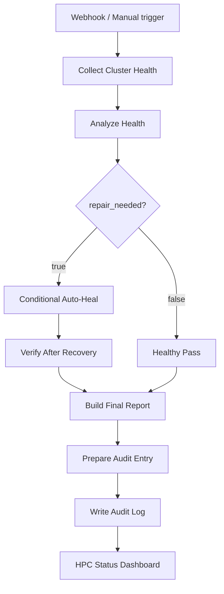
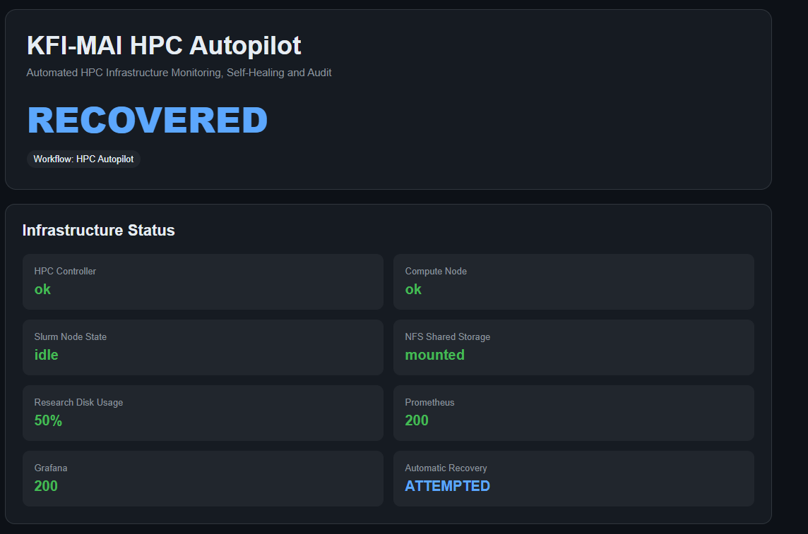

# n8n HPC Autopilot

A workflow that checks the whole cluster, repairs a small set of safe failures and writes an audit record. n8n runs outside the EC2 cluster and connects to `hpc-admin` over SSH. From there, nested SSH reaches `hpc-controller` and `hpc-compute01`.

## Health checks
- SSH reachability of controller and compute
- `slurmctld`, `slurmd` and Munge on both nodes
- `scontrol ping` and the Slurm node state
- NFS `/research` mount and disk usage
- Node Exporter on controller and compute, Prometheus, Grafana

## Supported auto-heal
Restart Munge, `slurmctld` or `slurmd`; retry the NFS mount; restart Node Exporter, Prometheus or Grafana; resume a Slurm node from DOWN/DRAIN once its services are back.

**Deliberately not automated:** force-resetting a Slurm node stuck in COMPLETING, and deleting data to fix a full disk. Those need a human decision.

## Result states
`HEALTHY` (nothing to do), `DEGRADED` (a problem was found) and `RECOVERED` (repaired and verified by a second check).

## Tests that exercised the repair path
| Failure created | Result |
|---|---|
| Compute Node Exporter stopped | Detected, restarted, final status RECOVERED |
| Grafana stopped | Detected, restarted, recovered |
| `slurmd` stopped | Detected, restarted, Slurm node returned to `idle` |

## Notes
- After an EC2 stop/start the public IP of `hpc-admin` can change and the n8n SSH node then fails with "Timed out while waiting for handshake". Update the credential or attach an Elastic IP.
- Credentials and SSH keys live in n8n's credential store, never in the repo.
