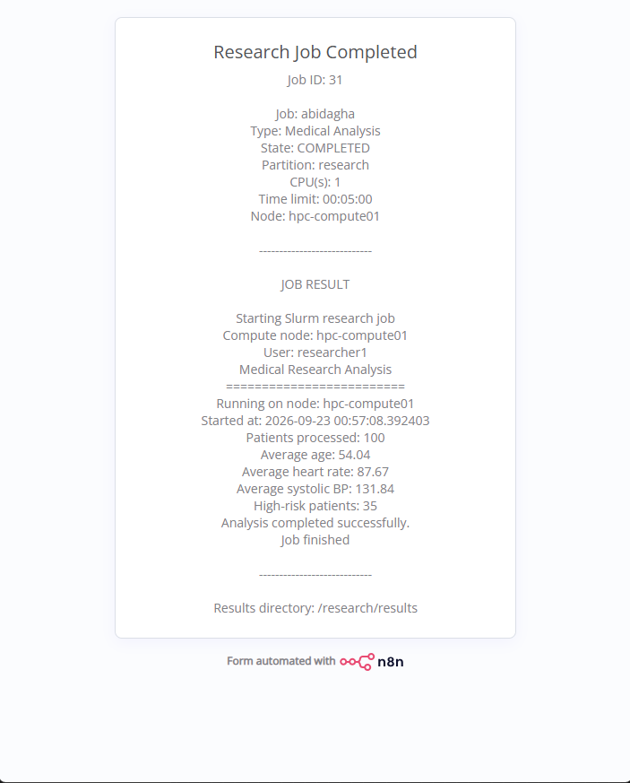

# n8n Research Job Portal

A browser form that lets a researcher without Linux skills submit an approved Slurm job and see the result. The workflow validates the input, submits `sbatch` as `researcher1`, reads the job state and shows the output on the form's completion page.

## Form fields
| Field | Meaning |
|---|---|
| Researcher | Identity used for the approved job |
| Job Name | Readable Slurm job name |
| Job Type | Approved script, for example Medical Analysis |
| CPU Count | CPUs per task |
| Time Limit | Maximum runtime |
| Partition | Queue, `research` in this lab |

## Behaviour
- `sbatch --parsable` returns just the job ID on stdout.
- Job state comes from `squeue` / `scontrol`. A very short job that already finished can report `NodeList=(null)`, so the workflow falls back to `hpc-compute01`.
- `/research/results` is group protected. The result file `medical-job-<ID>.out` is therefore read with `sudo -u researcher1`.
- Only approved scripts can be chosen. Free-text commands are never run.

## Possible next steps
Authentication for the form, a database for job history, more approved job types.
